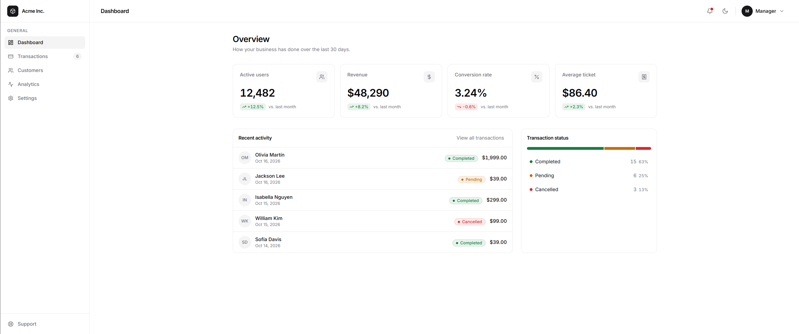
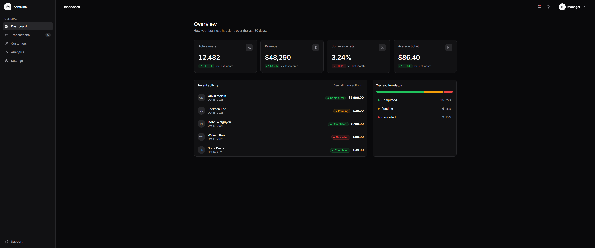

# Admin Dashboard Starter

[](https://admin-dashboard-starter-eight.vercel.app)

A clean, minimalist admin dashboard template built with **React + TypeScript + Tailwind CSS + Lucide Icons**. It ships with light/dark mode and a design inspired by Shadcn UI and Vercel.

<p align="center">
  
  
</p>


## Features

- **Five ready-made views:** Dashboard, Transactions, Customers, Analytics and Settings.
- **Light / dark mode** that follows the system preference, remembers your choice and avoids the flash of the wrong theme on load.
- **Advanced transactions table:** text search, date range, multi-select status filters with live counts, sorting and pagination.
- **Customers list** with search, sorting and a shortcut to each customer's transactions.
- **Analytics:** summary metrics, a daily activity chart (pure CSS, no chart library) and a payment-method breakdown.
- **Notifications panel** with unread tracking and deep links to transactions.
- **Settings:** profile form with validation, table density, theme and notification preferences.
- **Toasts, user menu and a mobile sidebar** that closes on `Esc` or outside click.
- **Accessible by default:** keyboard navigation, focus management, ARIA labels and live regions.
- **Keyboard shortcut:** press `/` to jump to the transactions search.
- **Respects reduced motion** (`prefers-reduced-motion`).
- **No extra runtime dependencies:** only React and Lucide Icons.

## Getting started

### Option A — Use this project as is

```bash
npm install
npm run dev
```

Then open the local URL that Vite prints (usually `http://localhost:5173`).

### Option B — Copy it into an existing Vite project

```bash
npm create vite@latest my-dashboard -- --template react-ts
cd my-dashboard
npm install lucide-react
npm install -D tailwindcss@3 postcss autoprefixer
```

Then:

1. Replace the `src/` folder with the one from this template (delete `App.css` and the sample assets).
2. Copy these files to the project root: `tailwind.config.ts`, `postcss.config.js` and `index.html` (it includes the theme anti-flicker script and the Inter font).
3. In `tsconfig.node.json`, add `"tailwind.config.ts"` to the `include` array.
4. Run `npm run dev`.

## Scripts

| Command             | Description                                   |
| ------------------- | --------------------------------------------- |
| `npm run dev`       | Start the development server                  |
| `npm run build`     | Type-check and create a production build     |
| `npm run typecheck` | Run the TypeScript compiler without emitting  |
| `npm run preview`   | Preview the production build locally          |

## Project structure

```text
src/
├── App.tsx                    # Shell, global state (active view, user, settings, session) and navigation
├── main.tsx                   # Mounts <ToastProvider><App /></ToastProvider>
├── index.css                  # Color tokens (light/dark) + Tailwind + reduced motion
├── types.ts                   # All shared types (ViewId, filters, toasts, settings…)
├── views/                     # One view per sidebar section
│   ├── DashboardView.tsx      # KPIs, recent activity and status breakdown
│   ├── TransactionsView.tsx   # Filters + advanced table
│   ├── CustomersView.tsx      # Customer list (search, sorting, jump to their transactions)
│   ├── AnalyticsView.tsx      # Metrics, daily chart and breakdown by payment method
│   └── SettingsView.tsx       # Profile (with validation), appearance and notifications
├── components/
│   ├── Sidebar.tsx, Header.tsx, ThemeToggle.tsx, StatCard.tsx, StatusBadge.tsx
│   ├── NotificationBell.tsx   # Presentational panel; state lives in App
│   ├── UserMenu.tsx           # Reports the chosen option via onAction
│   ├── ToastProvider.tsx      # Context + alerts viewport
│   ├── SignedOutScreen.tsx    # Screen after "Sign out" (demo)
│   ├── FilterBar.tsx, DataTable.tsx
│   └── PageHeader, MetricCard, BarChart, SegmentedControl, Switch
├── hooks/
│   ├── useTheme.ts, useDismiss.ts, useNotifications.ts
│   ├── useToast.ts            # Toast context and hook
│   └── useTransactionFilters.ts
├── data/                      # mock.ts, navigation.ts, notifications.ts
└── lib/                       # filters, customers, analytics, validation, format, utils
```

## Quick customization

- **Colors / theme:** edit the CSS variables in `src/index.css` (`:root` and `.dark`).
- **Navigation:** edit `src/data/navigation.ts`.
- **Real data:** replace `STATS` and `TRANSACTIONS` in `src/data/mock.ts` with your API. Components only depend on the types in `types.ts`.
- **New transaction status:** add it to `TransactionStatus` in `types.ts` and to `STATUS_CONFIG` in `StatusBadge.tsx`.
- **New section:** add its id to `ViewId` (`types.ts`), an item in `navigation.ts` and a `case` in `renderView` in `App.tsx`. The compiler warns you if any of them is missing (`assertNever`).
- **Routes:** the active view lives in state. For real URLs, add `react-router-dom` and turn the Sidebar `<button>`s into `<NavLink>`s.

## Notes

- All data is mock data and there is no real authentication. "Sign out" only shows a demo screen.
- Currency and dates are formatted with `Intl` in `src/lib/format.ts`. Change the locale there to localize them.
